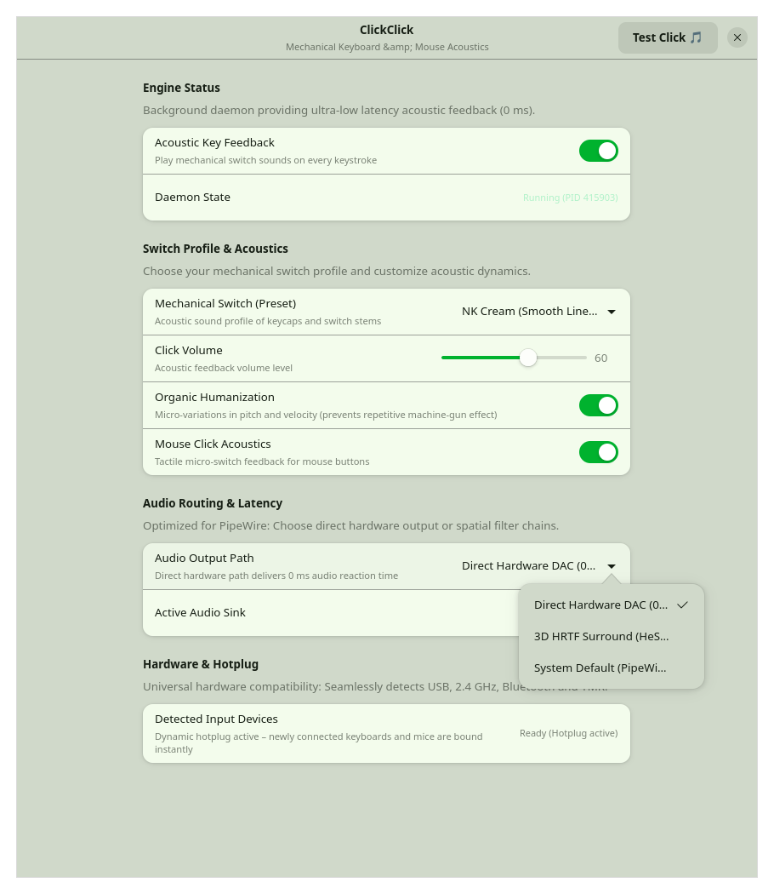
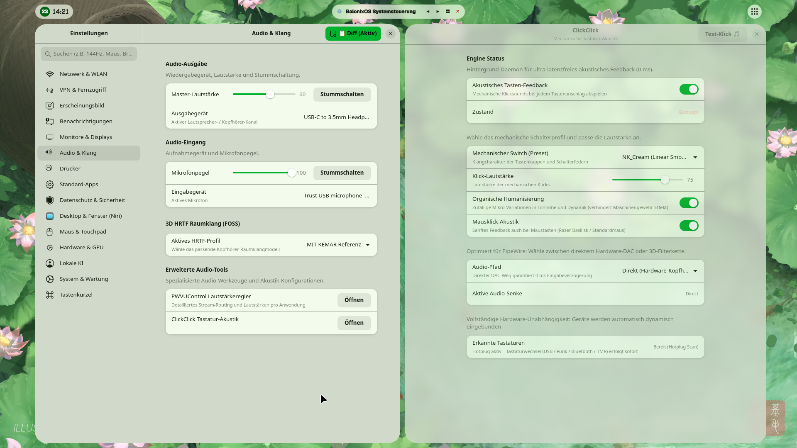

# ClickClick ⌨️🎵

> **Ultra-low latency mechanical keyboard & mouse acoustic feedback daemon for Linux (Wayland & X11).**

[](https://opensource.org/licenses/MIT)
[](https://www.rust-lang.org/)
[](https://kernel.org)
[](https://pipewire.org)
[](https://gnome.pages.gitlab.gnome.org/libadwaita/)



ClickClick brings authentic, satisfying mechanical keyboard and mouse acoustics to your desktop with **true sub-millisecond reaction times**, direct hardware PipeWire integration, and a modern Libadwaita control panel.

---

## ✨ Key Features

* **⚡ 0 ms Input Latency:** Directly monitors Linux kernel raw input devices (`/dev/input/event*`) via async `evdev`. No windowing server lag, no compositor overhead, and zero key interception delay.
* **🎧 PipeWire & Direct DAC Routing:**
  * **Direct Hardware DAC Mode:** Routes sound directly to your headphone amplifier/DAC with 0 ms audio buffer delay.
  * **3D HRTF Convolution Mode:** Integrates seamlessly with virtual 7.1 surround sound and spatial audio filter chains (e.g. HeSuVi / KEMAR).
* **🔌 Dynamic Hotplug Support:** Seamlessly transitions when plugging, unplugging, or switching between wired USB-C, 2.4 GHz wireless dongles, and Bluetooth keyboards.
* **🍃 Organic Humanization:** Prevents the repetitive "machine-gun effect" through subtle micro-variations (±2.5% pitch and dynamic velocity jitter) on every keystroke.
* **🖱️ Mouse Click Acoustics:** Optional high-precision tactile click feedback for mice (e.g. Razer Basilisk, Logitech G Pro, Glorious).
* **🎨 Modern Libadwaita Interface:** Elegant GTK4 settings app featuring live daemon status, interactive switch preset picker, real-time volume slider, and one-click sound tests.
* **📦 100% Free & Open Source (FOSS):** Bundled with vetted, MIT and CC0 licensed switch recordings.

---

## 🎛️ Bundled Switch Profiles

ClickClick includes high-quality, pre-decoded sound packs ready to use out of the box:

| Switch Profile | Sound Character | Switch Type | Upstream License |
|---|---|---|---|
| **NovelKeys Cream** | Deep, smooth, satisfying "thock" | Linear | **MIT** (Mechvibes) |
| **Cherry MX Black PBT** | Heavy, solid mechanical bottom-out | Linear Heavy | **MIT** (kbsim) |
| **Unicomp Classic** | Crisp, vintage buckling spring click | Buckling Spring | **CC0 / Public Domain** |
| **Default Clicky** | Sharp, tactile office click | Tactile Clicky | **CC0 / MIT** |
| **Tactile Mouse** | Soft, quiet optical/mechanical mouse switch | Micro-switch | **CC0 1.0 Universal** |

*(For complete licensing and original creator attributions, see [AUDIO_LICENSES.md](AUDIO_LICENSES.md).)*

---

## 🚀 Installation

### 1. Prerequisites (Input Permissions)
ClickClick reads raw keyboard events from `/dev/input/event*`. Your user must be a member of the `input` group:

```bash
sudo usermod -aG input $USER
```
*(Log out and back in once for the group membership to take effect).*

---

### 2. Nix / NixOS (Flakes)

Run directly without installing:
```bash
nix run github:saschlik/clickclick
```

Or add it to your `flake.nix`:
```nix
inputs = {
  clickclick.url = "github:saschlik/clickclick";
};
```

---

### 3. Arch Linux, Fedora, Ubuntu & Other Distributions

#### Build Dependencies
* **Rust toolchain:** `rustc`, `cargo` (1.75+)
* **Audio:** `alsa-lib` / `libasound2-dev`, `pipewire`
* **UI (optional for GUI):** `gtk4`, `libadwaita`, `python3-gobject`

#### Build & Install
```bash
git clone https://github.com/saschlik/clickclick.git
cd clickclick

# Build release binary
cargo build --release

# Install binary, CLI helper, and desktop GUI
sudo make install
```

---

## 🖥️ Usage

### Graphical Interface
Launch the modern settings panel via your app launcher (search **ClickClick**) or run:
```bash
clickclick gui
# or directly:
clickclick-settings
```

<p align="center">
  
</p>

### Command Line Control
```bash
clickclick start            # Start background daemon
clickclick stop             # Stop background daemon
clickclick status           # View active preset, volume, and routing state
clickclick preset nk_cream  # Switch to NovelKeys Cream
clickclick volume 85        # Set volume to 85%
clickclick test             # Play a test sample of the current preset
```

### Signal Control (Instant Hot-Reload)
ClickClick supports zero-downtime Unix signal control:
* `SIGUSR1`: Re-anchors the audio output stream (e.g. after changing default audio sinks).
* `SIGUSR2`: Hot-reloads volume and humanization settings without restarting the daemon.

---

## 🏗️ Architecture

```text
┌────────────────────────────────────────────────────────┐
│                   Linux Kernel                        │
│             /dev/input/event* (evdev)                  │
└──────────────────────────┬─────────────────────────────┘
                           │ Raw Key Down (1) [0 ms latency]
                           ▼
┌────────────────────────────────────────────────────────┐
│                 ClickClick Core (Rust)                 │
│  - Async Tokio event loop                              │
│  - Dynamic Hotplug discovery                           │
│  - In-Memory pre-decoded audio buffers                 │
│  - Micro-jitter humanization algorithm                 │
└──────────────────────────┬─────────────────────────────┘
                           │ Sub-millisecond stream
                           ▼
┌────────────────────────────────────────────────────────┐
│                   PipeWire / ALSA                      │
│        Direct Hardware DAC  ◄── OR ──►  3D HRTF Chain  │
└────────────────────────────────────────────────────────┘
```

---

## 📜 License

* **Code:** Licensed under the [MIT License](LICENSE). Copyright © 2026 Sascha (Saschlik).
* **Audio Assets:** Licensed under MIT / CC0. See [AUDIO_LICENSES.md](AUDIO_LICENSES.md) for full attribution.
